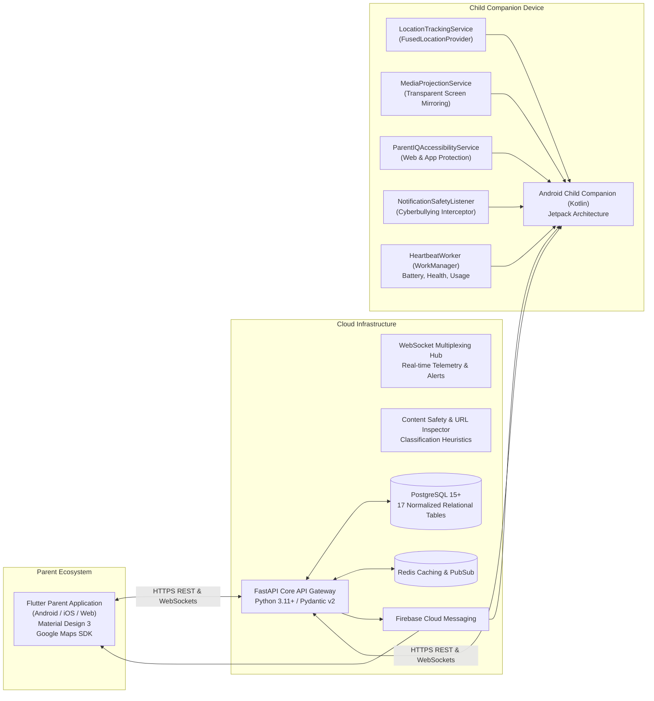

# PARENTIQ — Next-Generation Child Safety & Parental Control Platform

[](https://fastapi.tiangolo.com)
[](https://flutter.dev)
[](https://kotlinlang.org)
[](https://www.postgresql.org)
[](https://m3.material.io)

**PARENTIQ** is a production-grade, enterprise-ready child safety and parental control platform inspired by the full functionality of FlashGet Kids. It combines fintech-caliber security, modern Material Design 3 UI, and strict compliance with global child privacy standards (COPPA, GDPR-K, and Google Play Parental Control policies).

Unlike legacy surveillance tools or spyware, PARENTIQ operates as a **transparent, disclosed child safety companion**. It establishes mutual trust through recognizable app identity, persistent notification indicators, explicit per-session consent for screen sharing, and child empowerment tools including a one-tap Emergency SOS button and in-app screen time extension requests.

---

## 1. System Topology & Architecture

The platform consists of three core engineering subsystems:



---

## 2. Platform Modules & Feature Matrix

### A. Parent Application (Flutter / Material 3)
1. **Interactive Dashboard:** Live connection status, battery percentage, active geofence location, today's screen time breakdown, most-used apps, and quick-action emergency locks.
2. **Location Tracker & Geofences:** Real-time GPS tracking on Google Maps, historical route playback, circular safe zones (Home, School) with entry/exit push notifications.
3. **Screen Time Management:** Daily time limits, scheduled bedtimes, school study mode, instant remote device lockout, and incoming bonus-time approval dialogs.
4. **App Management & Restrictions:** Catalog of installed applications, daily category breakdown (Games, Social, Entertainment, Education), per-app time allowances, and instant blocking.
5. **Online Safety & URL Filtering:** Keyword-based cyberbullying and harassment alerts, adult/gambling web address filtering, and suspicious notification alerts.
6. **Live Monitoring Sessions:** Disclosed live screen mirroring and camera snapshots requiring child approval and displaying an unmistakable ongoing notification.
7. **Reports & Analytics:** Visual analytics comparing weekly screen time trends, category distributions, safety incidents, and device health history.
8. **Settings & Multi-Profile Support:** Manage multiple children, device pairing management, push notification preferences, and account security.

### B. Child Companion Application (Native Android / Kotlin)
1. **Recognizable Identity:** Prominent, unhidden launcher icon with full transparency disclosures.
2. **One-Tap Emergency SOS:** Prominent emergency button that dispatches high-accuracy GPS coordinates immediately across WebSockets and push notifications.
3. **Child-to-Parent Screen Time Requests:** Request +15, +30, or +60 bonus minutes with an optional reason note.
4. **Permissions Health Center:** Guided interface displaying the operational health of all 5 critical system permissions with direct settings intents.
5. **Disclosed Screen Sharing:** MediaProjection service with an unremovable Android status-bar notification and instant "Stop Sharing" revocation button.
6. **Battery-Aware Location Tracking:** Optimized FusedLocationProviderClient operating inside a foreground service.
7. **Intelligent Heartbeat Worker:** WorkManager periodic tasks (15-min cadence) reporting battery state, network type, and app usage without triggering OEM battery optimization killers.

---

## 3. Technology Stack

| Layer | Component | Technologies |
| :--- | :--- | :--- |
| **Backend API** | REST & WebSockets | Python 3.11+, FastAPI, Starlette, Uvicorn |
| **Data & ORM** | Relational Database | PostgreSQL 15+ (SQLite fallback in local dev), SQLAlchemy 2.0, Alembic |
| **Validation** | Data Schemas | Pydantic v2, Pydantic-Settings |
| **Security** | Authentication | JWT (HMAC-SHA256), Direct Bcrypt (12 rounds), RBAC |
| **Parent App** | Mobile / Web Client | Flutter 3.24+, Dart 3.5.4, Material Design 3, Google Maps SDK |
| **Child App** | Native Android Client| Kotlin 1.9+, Android SDK 34 (Android 8.0 to 14+), Jetpack, WorkManager, Coroutines |
| **Push & Realtime**| Push Notifications | Firebase Cloud Messaging (FCM), Native WebSockets |

---

## 4. Project Directory Structure

```text
PARENTIQ/
├── backend/                        # FastAPI Backend & WebSocket Service
│   ├── alembic/                    # Database migration scripts
│   ├── app/
│   │   ├── api/v1/endpoints/       # 12 Modular REST controllers (auth, devices, pairing, etc.)
│   │   ├── core/                   # Security, JWT, config, database sessions
│   │   ├── models/                 # 17 Normalized SQLAlchemy database models
│   │   ├── schemas/                # Pydantic v2 request/response schemas
│   │   ├── services/               # WebSocketManager, SafetyAnalyzer, Notifications
│   │   └── main.py                 # FastAPI application entrypoint
│   ├── tests/                      # Automated test suites (pytest)
│   ├── Dockerfile                  # Container build definition
│   └── requirements.txt            # Python dependencies
│
├── parent_app/                     # Flutter Parent Mobile Application
│   ├── lib/
│   │   ├── core/theme/             # Material Design 3 theme (Deep Navy, Royal Blue, Soft Cyan)
│   │   ├── models/                 # Strong-typed domain models
│   │   ├── screens/                # 8 Primary module screens + Auth & Pairing
│   │   ├── services/               # REST API client & WebSocket connector
│   │   └── main.py / main.dart     # Flutter application entrypoint
│   ├── test/                       # Dart unit and widget tests
│   └── pubspec.yaml                # Flutter dependencies
│
├── child_app/                      # Native Android Child Companion Application
│   ├── app/
│   │   ├── src/main/
│   │   │   ├── java/com/parentiq/child/
│   │   │   │   ├── data/           # ApiClient, EncryptedSharedPreferences, Models
│   │   │   │   ├── services/       # Location, MediaProjection, Accessibility, Heartbeat
│   │   │   │   ├── ui/             # MainActivity, PairingActivity, Permissions, Privacy
│   │   │   │   └── ParentIQChildApp.kt
│   │   │   ├── res/                # Material 3 XML layouts, drawables, themes, strings
│   │   │   └── AndroidManifest.xml # Disclosed foreground services & permissions
│   │   └── build.gradle.kts        # Android build configuration
│   └── build.gradle.kts            # Project Gradle configuration
│
└── docs/                           # Architecture, Database, API, and Deployment Guides
    ├── ARCHITECTURE.md             # High-level architecture & sequence diagrams
    ├── DATABASE_SCHEMA.md          # Complete 17-table relational specification
    ├── API_DOCUMENTATION.md        # Comprehensive REST & WebSocket endpoint guide
    ├── SECURITY_AND_PRIVACY.md     # Child privacy, COPPA/GDPR compliance, ethical oversight
    ├── FIREBASE_SETUP.md           # FCM push notifications configuration
    └── DEPLOYMENT_GUIDE.md         # Docker Compose, PostgreSQL & NGINX guide
```

---

## 5. Quickstart & Installation

### 5.1 Backend Setup

1. **Activate the Virtual Environment:**
   ```powershell
   # Windows PowerShell
   .\venv\Scripts\Activate.ps1

   # Linux / macOS
   source venv/bin/activate
   ```

2. **Install Dependencies:**
   ```bash
   pip install -r backend/requirements.txt
   ```

3. **Apply Database Migrations:**
   ```bash
   cd backend
   alembic upgrade head
   ```

4. **Launch the FastAPI Server:**
   ```bash
   uvicorn app.main:app --host 0.0.0.0 --port 8000 --reload
   ```
   - Swagger Documentation: [http://localhost:8000/docs](http://localhost:8000/docs)
   - Health Check: [http://localhost:8000/health](http://localhost:8000/health)

---

### 5.2 Parent Application (Flutter)

1. **Navigate to the Parent App directory:**
   ```bash
   cd parent_app
   ```

2. **Verify Static Analysis:**
   ```bash
   dart analyze lib
   ```

3. **Launch the Application:**
   ```bash
   flutter run
   ```

---

### 5.3 Child Companion Application (Android)

1. **Open `child_app` in Android Studio or compile via Gradle:**
   ```powershell
   cd child_app
   .\gradlew.bat assembleDebug
   ```

2. **Install on Child Device or Emulator:**
   ```bash
   adb install -r app/build/outputs/apk/debug/app-debug.apk
   ```

3. **Pair Device:**
   - In Parent App: Navigate to **Settings** -> **Add Child Device** to receive a 6-digit code.
   - In Child App: Enter the 6-digit code and tap **Pair & Connect Device**.

---

## 6. Automated Testing & Verification

Run the test suites across the repository to verify system integrity:

```powershell
# 1. Backend Integration & Unit Tests (100% pass)
cd backend
pytest tests/ -v

# 2. Parent App Analysis & Tests
cd ../parent_app
dart analyze lib
dart test test/parent_app_test.dart
```

---

## 7. Security & Transparency Guarantees

PARENTIQ strictly prohibits covert surveillance:
- **Zero Hidden Features:** No keyloggers, no stealth mode, and no disguised icons.
- **Auditable Sessions:** Screen sharing generates an active, dismissible notification banner with an instant stop control.
- **Hardware-Backed Encryption:** Device tokens are stored securely in Android `EncryptedSharedPreferences` backed by the Android KeyStore (AES-256 GCM).
- **Audit Trails:** All parental lock actions and permission modifications are written to immutable audit logs.

For detailed compliance documentation, see [SECURITY_AND_PRIVACY.md](docs/SECURITY_AND_PRIVACY.md).

