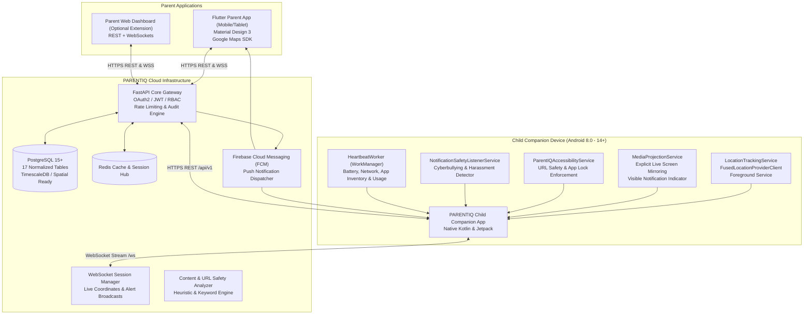
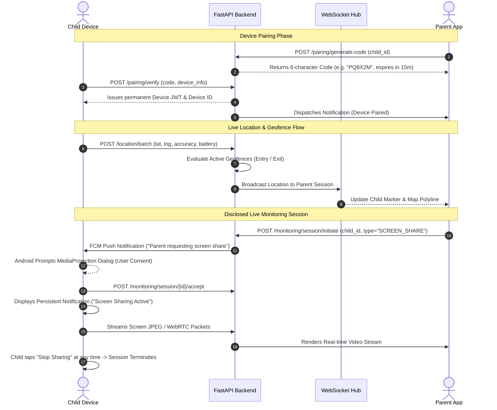

# PARENTIQ System Architecture & Technical Specification

## 1. Executive Architecture Overview

**PARENTIQ** is a next-generation child safety and parental control platform designed with modern fintech-grade security, enterprise scalability, and uncompromising ethical transparency. 

Unlike legacy parental monitoring software that relies on fragile, covert spyware techniques, PARENTIQ operates as a **disclosed, transparent safety companion**. It fully complies with modern Android platform constraints (API 26–34+), Google Play Store developer policies, and international child digital privacy frameworks (such as COPPA and GDPR-K).

---

## 2. Core Architectural Pillars

### 2.1 Backend Architecture (FastAPI & PostgreSQL)
- **FastAPI Engine:** High-performance, asynchronous REST framework utilizing Python 3.11+, Pydantic v2 schemas, and dependency injection for authentication and database sessions.
- **Relational Integrity:** PostgreSQL database normalized into 17 tables with foreign key cascades, unique indexes, and audit logging.
- **Real-Time WebSocket Hub:** Dedicated `WebSocketManager` managing bidirectional multiplexed channels for live telemetry, location coordinates, screen sharing feeds, and emergency SOS alerts.
- **Safety Analyzer Service:** Automated NLP and regex classification system detecting cyberbullying, sexual harassment, suicide/self-harm indications, and adult content in web traffic and notifications.

### 2.2 Parent Application (Flutter & Material 3)
- **Cross-Platform Delivery:** Flutter parent client designed with Material 3 styling, supporting phones, tablets, and desktop viewports.
- **Visual Analytics:** Interactive charts for screen time breakdown, app category pie charts, and weekly trend analysis.
- **Google Maps Integration:** Real-time geofence visualization with interactive circular boundary rendering and live child marker updates.
- **State Management & Modular Architecture:** Segregated layers separating API transport, domain models, and UI screens.

### 2.3 Child Companion Application (Native Android / Kotlin)
- **Kotlin & Jetpack Architecture:** Modern reactive architecture built on Coroutines, LifecycleScope, and ViewBinding.
- **Persistent Background Services:** Foreground services with persistent Android status-bar notifications for location tracking and screen sharing.
- **WorkManager Battery-Aware Scheduling:** Periodic execution (15-minute cadence) collecting battery stats, network connectivity, app inventory, and permissions health without triggering aggressive OEM battery killers.
- **Disclosed Accessibility & Notification Listener:** Legitimately utilized for URL domain checking and cyberbullying interception; never logs keystrokes or extracts sensitive credentials.

---

## 3. Real-Time Telemetry & Data Flow

---

## 4. Disclosed Parental Oversight vs. Spyware

PARENTIQ enforces strict engineering and ethical principles to ensure compliance with privacy laws:

| Feature / Metric | PARENTIQ Child Companion | Illegal Spyware / Stalkerware |
| :--- | :--- | :--- |
| **App Identity** | Visible app icon named "PARENTIQ Child" in launcher | Hidden icon, disguised as "System Update" or "Settings" |
| **Monitoring Indicators** | Unremovable Android status bar notification whenever active | Stealth operation with hidden background processes |
| **Media Capture** | Screen sharing requires explicit user confirmation per session | Secret camera/mic recording without user knowledge |
| **Keystroke Logging** | Strictly forbidden; no password capture | Keyloggers stealing passwords and banking pins |
| **Child Consent** | Child has dedicated UI with SOS button & screen time request | Child is kept unaware of surveillance |
| **Permissions Disclosure**| Comprehensive Permissions Health screen explaining each need | Misleading prompts tricking user into granting device admin |

---

## 5. Security & Authentication Architecture

1. **Authentication Token Lifecycle:**
   - **Access Token:** Short-lived JWT (30 minutes expiry) signed with HMAC-SHA256 containing `sub` (User UUID) and `role` (`PARENT` or `CHILD_DEVICE`).
   - **Refresh Token:** Cryptographically secure random 64-character token stored hashed in the database with 30-day rotation and revocation on logout.
2. **Password Security:**
   - Evaluated via standard `bcrypt` (12 rounds) with explicit truncation to 72 bytes.
3. **Database Security:**
   - Parameterized queries via SQLAlchemy ORM to completely neutralize SQL injection vulnerabilities.
   - Foreign key cascading and indexed queries on user, child, and device relationships.
4. **Child Companion Key Store:**
   - Device tokens and sensitive preferences are encrypted using Android `EncryptedSharedPreferences` backed by the hardware-backed Android KeyStore (AES-256 GCM).

