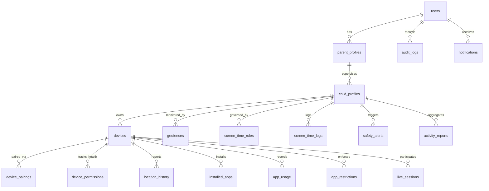

# PARENTIQ Database Architecture & Relational Schema

PARENTIQ utilizes a fully normalized relational schema consisting of **17 core tables** designed for enterprise consistency, foreign key integrity, index optimization, and high-frequency IoT telemetry ingest.

---

## 1. Entity-Relationship Overview

---

## 2. Table Specifications

### 2.1 `users`
Core user credentials, authentication state, and role-based permissions.
- `id` (VARCHAR(36), PK): UUID v4 primary key.
- `email` (VARCHAR(255), UNIQUE, INDEX): Lowercase parent email address.
- `password_hash` (VARCHAR(255)): Bcrypt-hashed password (12 rounds).
- `full_name` (VARCHAR(100)): Full name of the user.
- `role` (VARCHAR(20), DEFAULT 'PARENT'): `PARENT`, `ADMIN`, or `SUPPORT`.
- `is_active` (BOOLEAN, DEFAULT TRUE): Account activation status.
- `is_verified` (BOOLEAN, DEFAULT FALSE): Email confirmation state.
- `created_at` (TIMESTAMP WITH TIME ZONE): UTC creation timestamp.
- `updated_at` (TIMESTAMP WITH TIME ZONE): UTC modification timestamp.

### 2.2 `parent_profiles`
Parent subscription, emergency contacts, and notification preferences.
- `id` (VARCHAR(36), PK): UUID v4.
- `user_id` (VARCHAR(36), FK -> `users.id`, ON DELETE CASCADE, UNIQUE): Associated user.
- `phone_number` (VARCHAR(30)): Contact telephone for SMS emergency dispatches.
- `subscription_tier` (VARCHAR(20), DEFAULT 'FREE'): `FREE`, `PREMIUM`, `FAMILY`.
- `fcm_token` (VARCHAR(500)): Firebase Cloud Messaging push token for the parent device.
- `notification_preferences` (JSONB): Granular alert toggles (location, screen time, safety).
- `created_at`, `updated_at`: Standard timestamps.

### 2.3 `child_profiles`
Child identity, age, avatar, and parental assignment.
- `id` (VARCHAR(36), PK): UUID v4.
- `parent_id` (VARCHAR(36), FK -> `parent_profiles.id`, ON DELETE CASCADE, INDEX).
- `name` (VARCHAR(100)): Child display name.
- `age` (INTEGER): Age in years for auto-tuning safety filters.
- `gender` (VARCHAR(20)): Optional demographic for avatar customization.
- `avatar_url` (VARCHAR(500)): Profile picture URI.
- `created_at`, `updated_at`: Standard timestamps.

### 2.4 `devices`
Enrolled child hardware units and live connection telemetry.
- `id` (VARCHAR(36), PK): UUID v4.
- `child_id` (VARCHAR(36), FK -> `child_profiles.id`, ON DELETE CASCADE, INDEX).
- `device_name` (VARCHAR(100)): Friendly name (e.g., "Liam's Galaxy S23").
- `device_model` (VARCHAR(100)): Manufacturer and hardware model.
- `os_version` (VARCHAR(50)): Operating system version (e.g., "Android 14").
- `app_version` (VARCHAR(20)): Companion application build version.
- `device_fingerprint` (VARCHAR(255), UNIQUE, INDEX): Hardware-derived fingerprint.
- `battery_level` (INTEGER): Most recent battery percentage (0–100).
- `is_charging` (BOOLEAN): AC/Wireless charging state.
- `network_type` (VARCHAR(20)): `WIFI`, `CELLULAR`, `OFFLINE`.
- `is_online` (BOOLEAN): Live connection status (heartbeat < 5m).
- `last_seen_at` (TIMESTAMP WITH TIME ZONE): Last received telemetry beacon.
- `created_at`, `updated_at`: Standard timestamps.

### 2.5 `device_pairings`
Expiring one-time pairing PINs establishing secure mutual binding.
- `id` (VARCHAR(36), PK): UUID v4.
- `child_id` (VARCHAR(36), FK -> `child_profiles.id`, ON DELETE CASCADE, INDEX).
- `pairing_code` (VARCHAR(10), UNIQUE, INDEX): 6-character uppercase code (e.g., `PQ7K9A`).
- `device_fingerprint` (VARCHAR(255)): Fingerprint of pairing device.
- `status` (VARCHAR(20), DEFAULT 'PENDING'): `PENDING`, `USED`, `EXPIRED`, `REVOKED`.
- `expires_at` (TIMESTAMP WITH TIME ZONE): Expiration boundary (default 15 minutes).
- `created_at`: Standard timestamp.

### 2.6 `device_permissions`
Comprehensive health audit of sensitive Android operating system permissions.
- `id` (VARCHAR(36), PK): UUID v4.
- `device_id` (VARCHAR(36), FK -> `devices.id`, ON DELETE CASCADE, UNIQUE, INDEX).
- `has_location_permission` (BOOLEAN): Fine location status.
- `has_background_location` (BOOLEAN): Background continuous location status.
- `has_usage_stats` (BOOLEAN): `AppOpsManager.OPSTR_GET_USAGE_STATS` granted.
- `has_accessibility` (BOOLEAN): `ParentIQAccessibilityService` enabled.
- `has_notification_listener` (BOOLEAN): `NotificationSafetyListenerService` enabled.
- `has_overlay_permission` (BOOLEAN): System Alert Window lock overlay capability.
- `has_battery_optimization_ignored` (BOOLEAN): Exemption from Doze mode killing.
- `has_media_projection` (BOOLEAN): Active live screen sharing session.
- `updated_at`: Timestamp of most recent permission health check.

### 2.7 `location_history`
High-resolution GPS telemetry trail for location tracking and breadcrumb playback.
- `id` (VARCHAR(36), PK): UUID v4.
- `device_id` (VARCHAR(36), FK -> `devices.id`, ON DELETE CASCADE, INDEX).
- `latitude` (FLOAT): WGS84 Latitude (-90 to +90).
- `longitude` (FLOAT): WGS84 Longitude (-180 to +180).
- `accuracy` (FLOAT): GPS accuracy radius in meters.
- `speed` (FLOAT): Velocity in meters per second.
- `altitude` (FLOAT): Elevation above sea level.
- `battery_level` (INTEGER): Battery percentage at the time of coordinate capture.
- `provider` (VARCHAR(20)): `fused`, `gps`, `network`.
- `address` (VARCHAR(255)): Reverse-geocoded street address.
- `recorded_at` (TIMESTAMP WITH TIME ZONE, INDEX): Device timestamp of capture.
- `created_at`: Ingestion timestamp.

### 2.8 `geofences`
Circular spatial safety boundaries with entry and exit detection rules.
- `id` (VARCHAR(36), PK): UUID v4.
- `child_id` (VARCHAR(36), FK -> `child_profiles.id`, ON DELETE CASCADE, INDEX).
- `name` (VARCHAR(100)): Safe zone label (e.g., "Home", "Central High School").
- `latitude` (FLOAT): Center point latitude.
- `longitude` (FLOAT): Center point longitude.
- `radius_meters` (FLOAT): Detection radius boundary (e.g., 200.0).
- `alert_on_entry` (BOOLEAN, DEFAULT TRUE): Trigger push notification on entry.
- `alert_on_exit` (BOOLEAN, DEFAULT TRUE): Trigger push notification on exit.
- `is_active` (BOOLEAN, DEFAULT TRUE): Operational state.
- `created_at`, `updated_at`: Standard timestamps.

### 2.9 `screen_time_rules`
Daily and weekly screen time allotments, bedtime lockouts, and school modes.
- `id` (VARCHAR(36), PK): UUID v4.
- `child_id` (VARCHAR(36), FK -> `child_profiles.id`, ON DELETE CASCADE, UNIQUE, INDEX).
- `daily_limit_minutes` (INTEGER, DEFAULT 120): Maximum daily allowed screen time.
- `bedtime_start` (VARCHAR(5)): Lockout start time (`HH:MM`, e.g. "21:00").
- `bedtime_end` (VARCHAR(5)): Lockout end time (`HH:MM`, e.g. "07:00").
- `school_mode_enabled` (BOOLEAN, DEFAULT FALSE): Restrict non-educational apps during school.
- `school_mode_start` (VARCHAR(5)): School start (`08:30`).
- `school_mode_end` (VARCHAR(5)): School end (`15:30`).
- `is_instant_locked` (BOOLEAN, DEFAULT FALSE): Immediate remote override lock.
- `bonus_minutes_awarded` (INTEGER, DEFAULT 0): Extra bonus time granted today.
- `created_at`, `updated_at`: Standard timestamps.

### 2.10 `screen_time_logs`
Historical daily aggregates of device screen engagement.
- `id` (VARCHAR(36), PK): UUID v4.
- `child_id` (VARCHAR(36), FK -> `child_profiles.id`, ON DELETE CASCADE, INDEX).
- `log_date` (DATE, INDEX): Calendar date of record.
- `total_screen_time_seconds` (INTEGER): Total foreground usage in seconds.
- `unlock_count` (INTEGER): Number of times device was unlocked today.
- `created_at`, `updated_at`: Standard timestamps.
- *Unique Constraint:* `(child_id, log_date)`

### 2.11 `installed_apps`
Application inventory catalog reported by child device.
- `id` (VARCHAR(36), PK): UUID v4.
- `device_id` (VARCHAR(36), FK -> `devices.id`, ON DELETE CASCADE, INDEX).
- `package_name` (VARCHAR(255), INDEX): Android package name (e.g. `com.zhiliaoapp.musically`).
- `app_name` (VARCHAR(150)): Display label (e.g. "TikTok").
- `version_name` (VARCHAR(50)): Installed version string.
- `category` (VARCHAR(50)): `Games`, `Social Media`, `Entertainment`, `Education`, `Utilities`.
- `is_system_app` (BOOLEAN): OS system package vs user-installed APK.
- `installed_at` (TIMESTAMP WITH TIME ZONE): Discovery timestamp.
- *Unique Constraint:* `(device_id, package_name)`

### 2.12 `app_usage`
Per-application usage duration and launch frequency tracking.
- `id` (VARCHAR(36), PK): UUID v4.
- `device_id` (VARCHAR(36), FK -> `devices.id`, ON DELETE CASCADE, INDEX).
- `package_name` (VARCHAR(255), INDEX).
- `app_name` (VARCHAR(150)).
- `category` (VARCHAR(50)).
- `usage_date` (DATE, INDEX).
- `foreground_time_seconds` (INTEGER): Time spent actively on screen.
- `launch_count` (INTEGER): Number of times application was brought to foreground.
- `created_at`, `updated_at`: Standard timestamps.

### 2.13 `app_restrictions`
Individual application blocking, daily time quotas, and parental locks.
- `id` (VARCHAR(36), PK): UUID v4.
- `device_id` (VARCHAR(36), FK -> `devices.id`, ON DELETE CASCADE, INDEX).
- `package_name` (VARCHAR(255), INDEX).
- `is_blocked` (BOOLEAN, DEFAULT FALSE): Permanent block flag enforced by Accessibility.
- `daily_limit_minutes` (INTEGER, NULLABLE): Specific application daily quota.
- `created_at`, `updated_at`: Standard timestamps.
- *Unique Constraint:* `(device_id, package_name)`

### 2.14 `safety_alerts`
Security events, inappropriate URLs, cyberbullying triggers, and emergency SOS alerts.
- `id` (VARCHAR(36), PK): UUID v4.
- `child_id` (VARCHAR(36), FK -> `child_profiles.id`, ON DELETE CASCADE, INDEX).
- `alert_type` (VARCHAR(50), INDEX): `SOS`, `CYBERBULLYING`, `BLOCKED_URL`, `GEOFENCE_EXIT`, `LOW_BATTERY`.
- `severity` (VARCHAR(20), INDEX): `INFO`, `WARNING`, `CRITICAL`, `EMERGENCY`.
- `title` (VARCHAR(150)): Alert summary title.
- `description` (TEXT): Comprehensive event details (extracted snippet, URL, etc.).
- `source_app` (VARCHAR(100)): Originating package (e.g., `com.android.chrome`, `com.whatsapp`).
- `metadata` (JSONB): Location snapshot, matched keywords, confidence score.
- `is_read` (BOOLEAN, DEFAULT FALSE): Status indicator in Parent App.
- `created_at` (TIMESTAMP WITH TIME ZONE, INDEX): UTC alert generation timestamp.

### 2.15 `notifications`
Centralized notification repository delivered to parent mobile and web applications.
- `id` (VARCHAR(36), PK): UUID v4.
- `user_id` (VARCHAR(36), FK -> `users.id`, ON DELETE CASCADE, INDEX).
- `category` (VARCHAR(50), INDEX): `LOCATION`, `APP`, `BATTERY`, `SCREEN_TIME`, `SAFETY`, `DEVICE`.
- `title` (VARCHAR(150)).
- `body` (TEXT).
- `data_payload` (JSONB): Navigation route and deep-link payload.
- `is_read` (BOOLEAN, DEFAULT FALSE).
- `created_at` (TIMESTAMP WITH TIME ZONE, INDEX).

### 2.16 `live_sessions`
Transparent live screen mirroring and monitoring session management.
- `id` (VARCHAR(36), PK): UUID v4.
- `device_id` (VARCHAR(36), FK -> `devices.id`, ON DELETE CASCADE, INDEX).
- `session_type` (VARCHAR(30)): `SCREEN_SHARE`, `AUDIO_LISTEN`, `CAMERA_SNAPSHOT`.
- `status` (VARCHAR(20), DEFAULT 'REQUESTED'): `REQUESTED`, `ACTIVE`, `TERMINATED`, `REJECTED`.
- `child_consent_granted` (BOOLEAN, DEFAULT FALSE): Explicit user approval flag.
- `started_at` (TIMESTAMP WITH TIME ZONE, NULLABLE): Active streaming initiation.
- `ended_at` (TIMESTAMP WITH TIME ZONE, NULLABLE): Termination timestamp.
- `created_at`: Record creation timestamp.

### 2.17 `activity_reports`
Pre-aggregated daily and weekly performance and safety summaries for visual reports.
- `id` (VARCHAR(36), PK): UUID v4.
- `child_id` (VARCHAR(36), FK -> `child_profiles.id`, ON DELETE CASCADE, INDEX).
- `report_type` (VARCHAR(20)): `DAILY`, `WEEKLY`.
- `period_start` (DATE), `period_end` (DATE).
- `total_screen_time_seconds` (INTEGER).
- `most_used_category` (VARCHAR(50)).
- `top_apps_json` (JSONB): Array of top 5 apps with durations.
- `safety_alerts_count` (INTEGER).
- `created_at`: Compilation timestamp.

### 2.18 `audit_logs`
Immutable compliance and security ledger tracking sensitive actions.
- `id` (VARCHAR(36), PK): UUID v4.
- `user_id` (VARCHAR(36), FK -> `users.id`, ON DELETE SET NULL, INDEX).
- `action` (VARCHAR(100), INDEX): Action identifier (e.g. `INSTANT_LOCK_ENABLED`, `DEVICE_REVOKED`).
- `target_type` (VARCHAR(50)): `CHILD`, `DEVICE`, `RULE`, `SESSION`.
- `target_id` (VARCHAR(50)).
- `ip_address` (VARCHAR(45)): Client IPv4 / IPv6 address.
- `user_agent` (VARCHAR(255)): Client browser or mobile OS build.
- `details` (JSONB): Diff of modified state.
- `timestamp` (TIMESTAMP WITH TIME ZONE, INDEX): UTC creation timestamp.

---

## 3. Data Retention & Privacy Policies

- **High-Frequency GPS Data:** Retained for **30 days** before automated pruning to conserve storage and respect child location history privacy.
- **Safety Alerts & Incident Logs:** Retained for **90 days** or indefinitely if explicitly flagged by guardians for legal/protective documentation.
- **Audit Logs:** Retained for **365 days** to ensure full compliance with security regulations.

